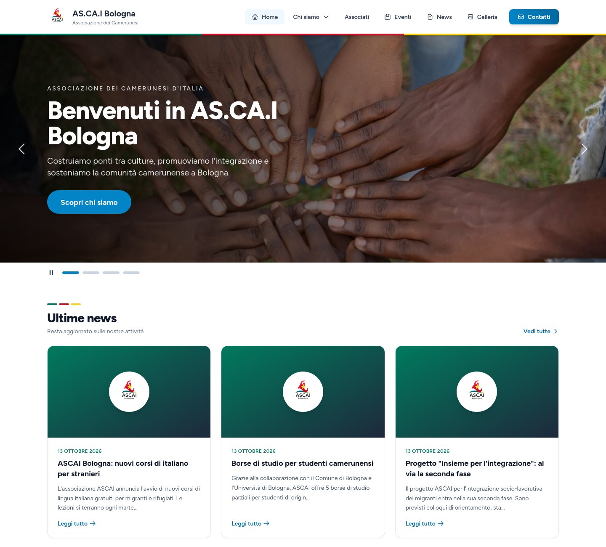

# 🇨🇲 AS.CA.I Bologna – Sito web

Sito dell'**Associazione dei Camerunesi d'Italia – sezione di Bologna**, online su **https://ascai-bo.it**.

<p align="center">
  <a href="https://ascai-bo.it">
    
  </a>
</p>

Applicazione **Laravel 12** renderizzata lato server con **Blade**, **Alpine.js** e **Tailwind CSS 3**: sito pubblico (news, eventi, galleria, pagine istituzionali, contatti) e pannello di amministrazione per gestire i contenuti.

> Questo documento è per chi sviluppa il sito. Per l'uso del pannello admin vedi [MANUALE_UTENTE.md](MANUALE_UTENTE.md).

---

## Indice

- [Funzionalità](#funzionalità)
- [Stack e architettura](#stack-e-architettura)
- [Installazione in locale](#installazione-in-locale)
- [Struttura del progetto](#struttura-del-progetto)
- [Database](#database)
- [Immagini e file caricati](#immagini-e-file-caricati)
- [SEO](#seo)
- [Sicurezza](#sicurezza)
- [Test e qualità del codice](#test-e-qualità-del-codice)
- [Deploy in produzione (Render)](#deploy-in-produzione-render)
- [Comandi Artisan del progetto](#comandi-artisan-del-progetto)
- [Storico delle modifiche](#storico-delle-modifiche)

---

## Funzionalità

### Sito pubblico
| Pagina | Percorso | Note |
|---|---|---|
| Home | `/` | Carousel, ultime 3 news, prossimi 3 eventi, ultime 4 foto (in cache 1 ora) |
| Chi siamo, Statuto, Staff, Associati | `/chi-siamo`, `/statuto`, `/staff-ascaibo`, `/associati` | Staff e dati di iscrizione/pagamento/PDF statuto modificabili dal pannello |
| Bilanci | `/bilancio` | Elenco e download dei PDF annuali |
| News | `/news`, `/news/{slug}` | Ricerca e filtro per date |
| Eventi | `/eventi`, `/eventi/{slug}` | Prossimi e passati, ricerca, filtro per luogo; foto dell'album collegato |
| Galleria | `/galleria`, `/galleria/{album}` | Album, griglia di miniature, visualizzatore a schermo intero |
| Contatti | `/contatti` | Modulo con limite di 5 messaggi / 24 ore per IP, notifica email agli admin |
| Pagine legali | `/privacy-policy`, `/cookie-policy`, `/note-legali` | |
| SEO | `/sitemap.xml`, `/robots.txt` | Generati dinamicamente |

### Pannello amministrativo (`/admin`, solo utenti con `is_admin`)
- **News** ed **Eventi**: bozza/pubblicato, copertina o locandina, video YouTube; gli eventi possono essere nascosti dal sito.
- **Galleria**: album (anche collegati a un evento), caricamento multiplo di foto, filtro per album.
- **Messaggi di contatto**: letti/non letti, filtro, risposta via email, eliminazione; contatore nella dashboard.
- **Staff**: consiglio direttivo e collaboratori con foto e ordinamento.
- **Dati associazione**: quota, IBAN, intestatario, causale, link al modulo di iscrizione, PDF dello statuto.
- **Bilanci**: caricamento dei PDF annuali.
- **Registro di audit**: chi ha creato, modificato o eliminato news, eventi e foto.
- Sulle pagine pubbliche gli admin vedono i pulsanti di modifica rapida.

La **registrazione pubblica è disabilitata**: gli account admin si creano dal seeder o dalla shell (vedi sotto).

---

## Stack e architettura

| Livello | Tecnologia |
|---|---|
| Backend | PHP **8.4** (produzione e CI), Laravel 12, Laravel Breeze (login/profilo in Blade) |
| Frontend | Blade, Alpine.js 3, Tailwind CSS 3 + `@tailwindcss/forms`, build con Vite 7 |
| Database | PostgreSQL in produzione, SQLite in locale |
| Hosting | Render (Docker), disco persistente da 1 GB per i file caricati |
| Dominio | `ascai-bo.it` su Aruba (DNS verso Render) |
| Email | SMTP Gmail dell'associazione (password per le app) |

**Scelte principali**
- **Solo Blade, niente SPA**: SEO immediato e un solo sistema da mantenere. Il progetto era nato dallo starter kit Vue/Inertia/Fortify, rimosso perché non veniva compilato ed era in conflitto con le pagine Blade.
- **Interattività con Alpine.js**: carousel, menu mobile, visualizzatore foto (`resources/js/lightbox.js`) e caricamento multiplo (`resources/js/gallery-uploader.js`).
- **Email inviate subito, senza coda**: il messaggio di contatto viene sempre salvato; se l'SMTP non risponde l'errore va nel log e il visitatore non vede errori (timeout SMTP 10 s).
- **Sito in italiano**: `APP_LOCALE=it`, traduzioni in `lang/it` e `lang/it.json`.

---

## Installazione in locale

**Requisiti**: PHP ≥ 8.4 con le estensioni `gd` (JPEG/WebP), `exif`, `pdo_sqlite`; Composer 2; Node.js 22.

```bash
git clone https://github.com/franksToscani/ascai_blog.git
cd ascai_blog

composer install
cp .env.example .env
php artisan key:generate
```

Nel `.env` imposta le credenziali dell'admin di sviluppo:
```env
ADMIN_EMAIL=tuo@indirizzo.it
ADMIN_PASSWORD=una-password-per-il-locale
```

Poi:
```bash
php artisan migrate --seed   # crea le tabelle, l'admin e news/eventi di esempio
php artisan storage:link     # senza questo le foto caricate non si vedono
npm install
composer run dev             # server PHP + coda + Vite insieme
```

Il sito è su `http://localhost:8000`, il pannello su `/admin`.

> `composer setup` esegue in un colpo solo install, `.env`, chiave, migrazioni, `storage:link` e build.
> Per ripartire da zero in locale: `php artisan migrate:fresh --seed`.

### Note sull'ambiente locale
- In locale PHP può essere più recente (es. 8.5): **non usare sintassi che non esiste in 8.4** (es. l'operatore pipe `|>`), altrimenti in produzione il sito non parte. `composer.json` fissa la piattaforma a PHP 8.4.1.
- Fuori dalla produzione le pagine hanno `noindex` e `robots.txt` blocca tutto: la copia locale non finisce su Google.
- Docker locale: `.env.docker` non è versionato, copialo da `.env.docker.example` e genera una `APP_KEY`.

---

## Struttura del progetto

```
app/
├── Console/Commands/          # images:standardize, gallery:thumbnails, storage:clean-orphans
├── Http/
│   ├── Controllers/
│   │   ├── PageController           # home e pagine istituzionali
│   │   ├── PostController           # news (pubblico + admin)
│   │   ├── EventController          # eventi (pubblico + admin)
│   │   ├── GalleryPhotoController   # galleria pubblica e foto (admin)
│   │   ├── AlbumController          # pagina pubblica dell'album
│   │   ├── ContactMessageController # modulo contatti e messaggi (admin)
│   │   ├── BilancioController       # download PDF bilanci
│   │   ├── SeoController            # sitemap.xml e robots.txt
│   │   ├── AdminDashboardController # dashboard e registro di audit
│   │   └── Admin/                   # Album, Staff, Dati associazione, Bilanci
│   └── Middleware/
│       ├── AdminMiddleware          # alias "admin": richiede is_admin
│       ├── CanonicalDomain          # *.onrender.com → dominio di APP_URL (301)
│       └── ForceHttps               # HTTP → HTTPS + HSTS in produzione
├── Mail/NewContactMessageNotification.php
├── Models/                    # Post, Event, Album, GalleryPhoto, ContactMessage,
│                              # StaffMember, Setting, Bilancio, AuditLog, User
├── Observers/AuditObserver.php
├── Services/ImageResizer.php  # standardizzazione immagini e miniature
└── Traits/HasSlug.php         # slug unico generato dal titolo

resources/
├── js/                        # app.js, lightbox.js, gallery-uploader.js
├── views/
│   ├── layouts/               # public (sito), app (admin), guest (login)
│   ├── pages/                 # home, chi-siamo, statuto, staff, associati, contatti, bilancio
│   ├── posts/, events/        # liste e dettagli pubblici + form di creazione/modifica
│   ├── gallery/               # index, album, partials (griglia, visualizzatore)
│   ├── admin/                 # dashboard, albums, gallery, staff, settings, bilanci, messaggi, audit
│   ├── seo/sitemap.blade.php
│   └── emails/new-contact-message.blade.php
lang/it/, lang/it.json         # traduzioni italiane
routes/web.php, routes/auth.php
tests/Feature/                 # test delle funzionalità
```

---

## Database

| Tabella | Contenuto |
|---|---|
| `users` | Utenti; `is_admin` abilita il pannello |
| `posts` | News: `title`, `slug` (unico), `content`, `cover_image`, `youtube_url`, `status` (`draft`/`published`), soft delete |
| `events` | Eventi: `title`, `slug`, `description`, `starts_at`, `ends_at`, `location`, `flyer_path`, `youtube_url`, `is_public`, `status`, soft delete |
| `albums` | `title`, `slug`, `description`, `date`, `event_id` (facoltativo), `is_visible` |
| `gallery_photos` | `image_path`, `thumb_path`, `title`, `caption`, `album_id`, `is_visible`, `published_at`, soft delete |
| `contact_messages` | `name`, `email`, `subject`, `message`, `read_at` |
| `staff_members` | `group` (`direttivo`/`collaboratori`), `role`, `name`, `description`, `photo_path`, `position` |
| `settings` | Coppie chiave/valore: `membership_fee`, `payment_holder`, `payment_iban`, `payment_reason`, `membership_form_url`, `statuto_pdf_path` |
| `bilanci` | `year` (unico), `title`, `file_path` |
| `audit_logs` | Creazioni/modifiche/eliminazioni di news, eventi e foto, con valori prima/dopo |

Regole da ricordare:
- `user_id` su news, eventi e foto è **`nullOnDelete`**: eliminare un utente non cancella i contenuti che ha creato.
- Eliminare un **album** non elimina le foto: restano "senza album".
- `Setting::get()` legge da cache; `Setting::put()` la invalida.

---

## Immagini e file caricati

Tutti i file caricati stanno sul disco `public` (`storage/app/public`, servito su `/storage`).

| Cartella | Contenuto |
|---|---|
| `gallery/` e `gallery/thumbs/` | Foto (max 2000 px) e miniature (600 px) |
| `posts/covers/`, `events/flyers/` | Copertine news e locandine eventi |
| `staff/` | Foto dello staff (400 px) |
| `documenti/` | PDF dello statuto (nome con data, il vecchio viene eliminato) |
| `bilanci/` | PDF dei bilanci |

`App\Services\ImageResizer` uniforma ogni immagine caricata: **JPEG qualità 82**, lato lungo massimo 2000 px, orientamento EXIF applicato, **metadati rimossi** (anche le coordinate GPS delle foto da telefono), trasparenza appiattita su bianco. I JPEG già conformi restano intatti. Upload fino a 10 MB (limiti PHP a 12 MB nel Dockerfile).

Il caricamento multiplo invia una richiesta per foto: nessun limite sulla dimensione complessiva e un errore non blocca le altre foto.

---

## SEO

- Ogni pagina definisce `title` e `description`; news ed eventi le ricavano dal contenuto.
- Open Graph / Twitter card: copertina o locandina quando c'è, altrimenti `public/images/og-default.jpg` (1200×630).
- `<link rel="canonical">` e redirect 301 da `*.onrender.com` verso `APP_URL`.
- JSON-LD: `NGO` in home, `NewsArticle` sulle news, `Event` sugli eventi.
- `/sitemap.xml` con pagine, news, eventi e album pubblicati; `/robots.txt` dinamico.
- Google Search Console: proprietà di tipo Dominio `ascai-bo.it`, verificata con record TXT su Aruba. In alternativa si può usare la variabile `GOOGLE_SITE_VERIFICATION` (meta tag).

---

## Sicurezza

- Nessun segreto nel repository: `APP_KEY`, credenziali SMTP e admin si impostano come variabili d'ambiente (su Render con `sync: false`).
- Solo HTTPS in produzione, con HSTS.
- Protezione CSRF su tutti i form, limite di tentativi su login e modulo contatti.
- Tutti i contenuti inseriti dagli utenti vengono mostrati con escaping (`{{ }}`); i dati JSON nelle pagine usano `JSON_HEX_TAG`.
- Rotte admin protette da `auth` + `admin`.

---

## Test e qualità del codice

```bash
php artisan test        # suite completa (non serve avere Vite avviato)
npm run lint            # ESLint
npm run format:check    # Prettier
vendor/bin/pint         # stile PHP
```

La CI di GitHub (`.github/workflows`) esegue test e lint su PHP 8.4 a ogni push su `main`.

---

## Deploy in produzione (Render)

Ogni push su `main` avvia il deploy automatico. Il `Dockerfile`:
1. compila gli asset con Node 22;
2. installa le dipendenze PHP senza quelle di sviluppo;
3. usa `php:8.4-cli` con GD (JPEG/WebP), EXIF, OPcache, `short_open_tag=Off`, upload fino a 12 MB;
4. all'avvio esegue `migrate --force`, `optimize`, `storage:link` e lancia il server PHP con 4 worker.

### Variabili d'ambiente su Render
| Variabile | Valore |
|---|---|
| `APP_ENV` / `APP_DEBUG` | `production` / `false` |
| `APP_KEY` | segreta, solo nella dashboard |
| `APP_URL` | `https://ascai-bo.it` |
| `APP_LOCALE` | `it` |
| `DB_*` | dal database Postgres di Render |
| `MAIL_HOST` / `MAIL_PORT` | `smtp.gmail.com` / `587` |
| `MAIL_USERNAME` / `MAIL_PASSWORD` | account Gmail e password per le app (segrete) |
| `MAIL_FROM_ADDRESS` / `MAIL_FROM_NAME` | indirizzo Gmail / `AS.CA.I Bologna` |

Health check: `/up`. Il disco persistente è montato su `/app/storage`.

### DNS su Aruba (non modificare)
| Tipo | Nome | Valore |
|---|---|---|
| A | `@` | `216.24.57.1` |
| CNAME | `www` | `ascai-blog.onrender.com` |
| TXT | `@` | `google-site-verification=…` |
| TXT | `@` | `v=spf1 include:_spf.aruba.it ~all` |

### Creare o cambiare la password di un admin (Shell di Render)
```bash
php artisan tinker --execute="App\Models\User::where('email','EMAIL')->first()?->update(['password' => 'NUOVA_PASSWORD']);"
```

---

## Comandi Artisan del progetto

Tutti i comandi distruttivi mostrano prima cosa farebbero.

| Comando | Cosa fa |
|---|---|
| `php artisan images:standardize [--dry-run]` | Converte nel formato standard le immagini caricate prima di `ImageResizer` |
| `php artisan gallery:thumbnails` | Crea le miniature mancanti delle foto |
| `php artisan storage:clean-orphans [--force]` | Elenca (e con `--force` elimina) i file non più collegati a nessun contenuto; ignora i file dell'ultima ora |

---

## Storico delle modifiche

### Ottobre 2026
- **Sicurezza**: rimossi dal repository `APP_KEY` e password degli admin, registrazione pubblica chiusa.
- **Bug**: email di contatto mai inviate (template, variabile riservata, coda senza worker); cache della galleria in home; ricerca eventi admin; upload limitati a 2 MB e foto da telefono rifiutate; cancellazione a cascata dei contenuti eliminando un utente; sitemap in errore 500 per `short_open_tag`.
- **Pulizia**: rimossi Vue/Inertia/Fortify e la 2FA non funzionante; dipendenze aggiornate (Laravel 12.69, 0 avvisi Composer); PHP 8.4 e Node 22 in produzione; OPcache e 4 worker.
- **Nuove funzioni**: gestione messaggi (letti/non letti, eliminazione), sito in italiano, immagini standardizzate senza metadati GPS, galleria ad album con caricamento multiplo e visualizzatore, SEO completo con sitemap e dati strutturati, dominio unico `ascai-bo.it`, Staff e Dati associazione modificabili dal pannello.

### Novembre – Dicembre 2025
- Prima versione: news, eventi, galleria, contatti, bilanci, pannello admin, registro di audit, carousel in home, layout pubblico e footer.

---

## Autore

**Franks Toscani Koudja** – progetto per AS.CA.I Bologna. Tutti i diritti riservati.
